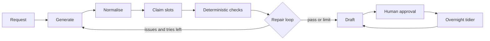

# Tortoise

Tortoise is a slow, verified marketing team for one company.
One plain-English request becomes a campaign package with videos, posts and an optional article.
Every product sentence must come from a protected claim bank.
Unsupported claims are flagged before a human sees the draft.
Nothing is ever published, and the overnight tidier checks drafts against the same rules.

The hosted demo uses a fictional company, Brightleaf Coffee, and a fictional coffee subscription.

## Architecture



The content agent writes a draft as JSON.
The normaliser repairs mojibake, dash variants, near-miss placeholders and spacing.
Product lines are tied to the protected claim bank, then checked for exact wording, allowed placeholders,
aspect ratios, cross-offering leaks, banned terms and language.
A failed part is rewritten with a short fix brief. Anything still wrong is listed as unverified and the
draft is marked `needs_review`.

## Local setup on Windows

```powershell
py -m venv .venv
.\.venv\Scripts\Activate.ps1
$env:PYTHONUTF8 = "1"
python -m pip install -r requirements.txt
Copy-Item .env.example .env
# Edit .env and set LLM_BASE_URL, LLM_API_KEY and LLM_MODEL.
python scripts\demo_seed.py
uvicorn agent_team.main:app --reload
```

Open http://127.0.0.1:8000/ui.

The database path comes from `DB_PATH` and defaults to `agent_team.db` in the current directory.
The app creates the file and its tables on first start, so it can start with no existing database.

## Demo steps

1. Open `/ui` and pick the `brightleaf.example` tenant.
2. If `DEMO_KEY` is set, paste the key when the page asks for it. The key stays in memory for this tab only.
3. Generate a package from the request box.
4. Read the summary, videos and posts. Red chips mean `needs_review`; amber means a repair ran.
5. Approve or reject the draft.
6. Run the tidier and read its report. It never edits a draft unless you pass `apply=true`.

The seed creates one fictional tenant and three sample campaigns. It is idempotent: if the tenant exists,
the script does nothing.

## Deploy on Render

`render.yaml` defines a Python web service:

* Build command: `pip install -r requirements.txt`
* Start command: `python scripts/demo_seed.py && uvicorn agent_team.main:app --host 0.0.0.0 --port $PORT`
* Health check: `/health`
* Environment: `PYTHONUTF8=1`, `PYTHON_VERSION`, `LLM_API_KEY`, `LLM_BASE_URL`, `LLM_MODEL`, `DEMO_KEY`

Set the LLM values and `DEMO_KEY` in the Render dashboard. They are marked `sync: false` on purpose.

Add a Render Cron Job that runs the tidier once a night:

```bash
curl -X POST "https://YOUR-SERVICE.onrender.com/tenants/brightleaf.example/tidier/run" \
  -H "X-Demo-Key: $DEMO_KEY" \
  -H "content-type: application/json" \
  -d "{}"
```

The free tier sleeps after a period without traffic. The first request after a sleep can be slow.

## Open-weight models

The default path uses any OpenAI-compatible endpoint. The examples in this repo target:

* `openai/gpt-oss-120b`
* `qwen/qwen3.8-27b`

The Anthropic checker is disabled unless `CHECKER_PROVIDER=anthropic` and `ANTHROPIC_API_KEY` are both set.
Ollama works through the same variables:

```dotenv
LLM_BASE_URL=http://localhost:11434/v1
LLM_API_KEY=ollama
LLM_MODEL=llama3.1
```

## How the checks work

1. The writer gets the request, the company brief, protected offering rules and recent approved style examples.
2. Every product sentence must be copied word for word from that offering's claim bank.
3. Visuals of the product must be exactly `[WHAT THE USER SEES]`. Other placeholders must be approved and empty.
4. Aspect ratios, banned terms, cross-offering capabilities and language are checked in code.
5. A failed part is regenerated once with a fix brief. Surviving issues are listed under `unverified_claims`.
6. A draft with surviving issues gets status `needs_review`. A clean draft stays `draft`.

`repair_log` records each repair attempt and how many violations remained.

## Overnight tidier

`agent_team/tidier.py` sweeps `draft` and `needs_review` items at 02:00 in the tenant timezone.
It makes no LLM call, so a run is reproducible and cannot invent a fact.

* Normalisation runs first, and every repair is recorded with its path, before text and after text.
* Fixable issues are repaired in code, including em dashes, double hyphens and never-claim terms.
* Anything else is flagged for a human, such as a product line outside the claim bank.
* The default run only writes a report. `apply=true` writes back `SANITIZED` drafts and keeps `original_text`.

Run it by hand with `POST /tenants/{tid}/tidier/run` and read the last result with
`GET /tenants/{tid}/tidier/latest`.

## API notes

* `GET /health` returns `{"status": "ok"}`.
* `GET /ui` serves the demo. `GET /` serves the older full onboarding UI.
* When `DEMO_KEY` is set, `POST /tenants/{tid}/command`, `PATCH /tenants/{tid}/outputs/{id}` and
  `POST /tenants/{tid}/tidier/run` require the `X-Demo-Key` header.
* Generate is limited to 10 requests per hour per client address, in memory.
* Every output is a draft. Nothing is auto-posted.

## Safety

* Never commit a real `.env`. Only `.env.example` is tracked.
* Product sentences must be word for word from the claim bank.
* The protected rules in `agent_team/offerings.py` are separate from the editable company brain.
* Approved packages become style examples for tone and structure only, never a source of product facts.
* Sample data is fictional. The demo company is Brightleaf Coffee.
